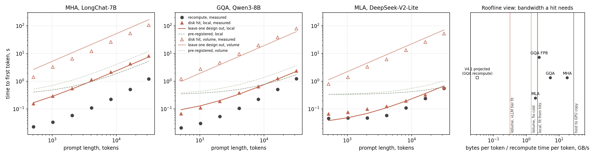

# Exp01 cost model, topic 20: lab note

Run by the Vizuara research team on 4 November 2026 on Modal.

## In short

We asked whether a cost model with measured terms predicts, for an attention design it was not fitted on, whether loading a cached prefix from disk beats recomputing it.

**G1 fails on both tiers, and the kill clause on T0 fires on both.** These are the pre-registered results, with all three designs now on the local disk after an approved rerun of MHA.

- Local disk: decision accuracy is 21 of 21, hit error is 13.2% (limit 20%), and T0 varies by a factor of 2.20 (limit 1.5). G1 fails on the T0 clause alone. B varies by 1.23.
- Volume: decision accuracy is 21 of 21, hit error is 43.7%, and T0 varies by a factor of 6.7. G1 fails on two clauses. No single per-chunk cost fits the three designs.
- On both tiers recomputing was faster in all 21 cells, so always answering "recompute" also scores 21. The accuracy clause had no power in this run.

By the review's rule, this result points to the scheduling angle of section 8. That reading stands after the rerun.

Separately, and not as a change to the rule: the T0 failure on the local disk comes from MLA alone. T0 is 27.6 ms for GQA, 29.5 ms for MHA and 60.8 ms for MLA. MLA is also the design whose licence question is pending with the project lead (see below); its numbers are flagged, and without them no three-design test exists. A pre-registered projection of MHA's hit times from GQA and MLA alone, frozen before the rerun, came within 7.4%. So the bytes term transfers well on the local disk, and the failure is in the fixed term. Why that fixed term differs is a post hoc question.

The largest finding is about measurement. Day 1's 35 GB/s from the local disk was a cache. The review's 64 GiB eviction window is far too small; it takes more than 1 TiB of later writes. After that, reads ran at about 3.4 GB/s. The superseded predictions, built on that number, had Qwen3-8B loading faster from 16,384 tokens, where it measured about 2.5 times slower.

## Costs

Modal's billing report for apps named `irb20-exp01` shows **$17.69** for 4 November, over 38 rows, and our own estimate from `results/costlog.jsonl` is $17.47 (`results/billing.json`). The first run was $16.07 (`results/billing_before_mha_rerun.json`), and the MHA rerun added $1.62, against an estimate of about $1.25. Volume storage is billed separately and is not in that figure: the Volume still holds about 45 GB of weights, plus prompts, traces and results, within the 1 TiB a month that the pricing page includes.

H100 time recorded is 3.32 hours: 0.217 for smoke tests, 0.365 for day 1 and its follow-up probes, 1.238 for the first local arms, 1.176 for the Volume arms and 0.325 for the MHA rerun. The 3.0 hour cap was lifted for the rerun only, by the project lead (amendment 4). The first 2.996 hours stayed inside the cap. L4 smoke tests and diagnostics took 0.81 hours and $1.01, and CPU containers took $0.11. The review planned 2.5 hours. The overrun comes from the filler writes and from Volume reads that were far slower than planned. We stopped the last Volume arm by hand at the cap, and its cost record was written by hand from the launch and stop times.

## What ran

**Models.** All three were ungated on the Hugging Face API on the day, with no acceptance step. LongChat-7B (MHA, 524,288 bytes per token, 32 layers) at revision 389eea14, Qwen3-8B (GQA, 147,456 bytes, and 73,728 with FP8) at revision b968826d, read-only from `irb15-exp01`, and DeepSeek-V2-Lite-Chat (MLA, 31,104 bytes) at revision 85864749. Measured bytes on disk per token matched the config value exactly for all of them. **Pending with the project lead, not decided here:** DeepSeek-V2-Lite-Chat carries the DeepSeek License Agreement, whose text says "You and DeepSeek agree" and lists use restrictions. There is no click-through or gate, and the review names this model, so we used it. Every MLA number in this note is flagged as pending that decision. If "requires acceptance" is read more strictly, the MLA numbers should be dropped, and the three-design test then does not exist.

**Software.** vLLM 0.32.0 and fio 3.33 on Python 3.12, with 238 packages pinned by hash, none uploaded in the 14 days before the run (`requirements.lock.txt`, `make_lock.py`). This machine could not reach pypi.org, so the resolver ran in a Modal CPU container. We read LMCache's disk backend and vLLM connector, and vLLM's tier code, before relying on them, and switched off both packages' usage telemetry through their environment variables. No API key or Hugging Face token was used. `analyze.py` ran on this Mac with the library versions listed in `summary.json`, which are not those of the lock.

**Workload.** wikitext-103 (card licence cc-by-sa-3.0 and gfdl), disjoint segments cut to exact lengths per tokenizer: 512, 1,024, 2,048, 4,096, 8,192, 16,384 and 32,000 tokens, five prompts per length, one output token, temperature 0. We used 32,000 rather than 32,768 to leave room for the 16 tail tokens. We set vLLM's batch limit to 33,024 tokens, so that no prompt was split into chunks during prefill.

**Protocol per arm.** A plain vLLM server for the `cold` and `cold_tail` rows. A second server with the connector to store each prompt. For the local disk, 1,100 GiB of filler and a sentinel read. Then a third server, with an empty CPU tier, for the `hit` rows, each prompt read once. On the Volume the store and the hit ran in two different containers. Volume arms reuse the local arm's cold rows.

## Changes from the plan

Four amendments are in `decision_rule_amendments.json`. The first three were written before any full arm measured a hit, the fourth before any MHA local hit, and none changes a gate's thresholds.

**LMCache was replaced by vLLM's native tier.** This is the review's named fallback, though for a different reason than the review expected: LMCache 0.5.6 runs with vLLM 0.32.0, but it restores wrong KV. In the L4 smoke test on LongChat, the first greedy token after a hit differed from the cold reference, for example "," at a logprob of minus 0.96 against "'" at minus 1.21, and the answers changed once vLLM's block free list wrapped around (`results/diag_mha.json`). A GPU prefix-cache hit of the same request matched exactly, so the fault is in the restore. Turning off async scheduling, using one reader thread, connector V3 and the other KV layout did not fix it, and vLLM's in-tree adapter did not start. We did not find the root cause. The check that caught it was the restore control, K8, and its logprob diagnostic. This finding is worth reporting to the LMCache maintainers, once someone has reproduced it on an H100; our evidence is from an L4.

**The cold protocol changed.** See the next section. Amendment 2 contained a mistake: it was written before we had read the full output of the eviction probe, and it said G0 failed. Amendment 3 corrects it and withdraws that clause. Both stay in the file. The hash chain is in `logs/`: `e22d3089` for the rule before any measurement, `b1f3645e` for the corrected predictions before any arm, and a superseded stage in between, kept with its file.

**All three designs ran on the Volume.** The review ran only Qwen3-8B there, which makes a 21-cell test per tier impossible. Since the review's 64 GiB window failed, Volume arms ran at five prompts for every design.

**MHA local rerun (amendment 4).** the project lead approved it , after the first version of this note. The arm ran alone among this experiment's arms, with the hour cap lifted for this arm only. To keep its cost down it reused the cold rows of the first MHA arm, as the Volume arms do. The amendment file's SHA-256 is `3d4b96db`, logged in `logs/decision_rule_amendments_sha256_4.log` before the arm launched, and `analyze.py` checks it.

We saw smoke hits at two lengths before fixing the predictions. The predictions are mechanical, from a formula in the rule, so those hits could not move them.

## What storage a Modal H100 container has

The container reports Linux 4.19.0-gvisor, 1 TiB of memory, and an `overlayfs` root with no meaningful size. `nvidia-smi` reports an H100 80GB on PCIe gen 4 x16. Pinned host-to-GPU copies ran at 27.65 GB/s, against 9.38 GB/s unpinned.

**Local disk.** On day 1, reads at 16 MiB and queue depth 8 ran near 35 GB/s, direct or buffered, and a re-read was no faster, so the review's 1.5 ratio did not fire. It could not fire, because the first read was served from memory. `O_DIRECT` is accepted and appears to change nothing. fio's 4 KiB median of 5.1 microseconds also looks like memory, but that median misleads here: a few slow first touches fill the cache for the many reads that follow.

`results/cold_local_probe.json` wrote a 128 GiB set and then 1,000 GiB of filler. First reads of set files then ran at 3.14 to 3.46 GB/s (a 10% spread) and immediate re-reads at 27.5 to 36.1 GB/s, a ratio near 10. Files nearer the end of the set still read at 10.8 to 21.9 GB/s, so eviction needs about 1,050 GiB of later writes. Writes ran at about 4 GB/s. We cannot say from inside the sandbox that these cold reads reach an SSD. First-touch reads of 4 KiB at offsets 4 MiB apart took 23 microseconds at the median and 4.8 ms at the 90th percentile, which is not the shape of one local NVMe drive. "Local" in this note means this path, whatever serves it.

**Volume.** A fresh H100 container reading files that another container wrote saw 1.27, 1.41 and 1.63 GB/s, then 25.1, 32.3 and 25.9 GB/s on re-read, a ratio of up to 22.9 (`results/volume_cold_probe.json`). A read in the writing container, which is what day 1 did, runs at about 25 GB/s. So on this tier a fresh container is a real cold read, and repeating a hit is not.

## Main table

Median time to first token in seconds, for the same request of L plus 16 tokens. Recompute is `cold_tail`. MLA columns are pending the licence decision. MHA Volume cells have 5 prompts, except 2,048 (4), 16,384 (3) and 32,000 (4), because we stopped that arm at the cap. MHA local cells are incomplete too, because that arm reached its time limit: 512 (4), 1,024 (3), 2,048 (4), 4,096 (3), 8,192 (4), 16,384 (2) and 32,000 (2).

| Length | MHA recompute | MHA local hit | MHA Volume hit | GQA recompute | GQA local hit | GQA Volume hit | GQA FP8 recompute | GQA FP8 local hit | MLA recompute | MLA local hit | MLA Volume hit |
|-|-|-|-|-|-|-|-|-|-|-|-|
| 512 | 0.023 | 0.156 | 1.42 | 0.021 | 0.068 | 1.23 | 0.031 | 0.061 | 0.046 | 0.067 | 0.81 |
| 1024 | 0.034 | 0.291 | 3.29 | 0.030 | 0.109 | 2.79 | 0.034 | 0.080 | 0.047 | 0.077 | 1.40 |
| 2048 | 0.059 | 0.546 | 6.49 | 0.054 | 0.190 | 4.70 | 0.057 | 0.114 | 0.048 | 0.100 | 3.37 |
| 4096 | 0.110 | 1.136 | 12.26 | 0.106 | 0.378 | 9.65 | 0.110 | 0.191 | 0.058 | 0.124 | 6.19 |
| 8192 | 0.227 | 2.113 | 26.26 | 0.223 | 0.643 | 19.95 | 0.228 | 0.334 | 0.111 | 0.195 | 13.23 |
| 16384 | 0.511 | 4.291 | 53.41 | 0.513 | 1.258 | 38.42 | 0.510 | 0.624 | 0.240 | 0.325 | 26.02 |
| 32000 | 1.216 | 8.076 | 104.69 | 1.232 | 2.363 | 79.37 | 1.215 | 1.161 | 0.559 | 0.580 | 52.59 |

The one cell where a disk hit beat recompute is Qwen3-8B with FP8 at 32,000 tokens on the local disk, 1.161 s against 1.215 s, with a measured crossing near 28,300 tokens. MLA at 32,000 comes close, 0.580 s against 0.559 s. Without FP8, a Qwen3-8B disk hit took 1.9 to 3.6 times as long as recompute at every length.

## Gates

All of this section is pre-registered: the gates are the review's, with the formulas fixed in advance.

**G0: passes on the local disk, with the caveat above.** Cold reads repeat within 10.2% over six runs (limit 15%). End-to-end bandwidth is 3.39 GB/s from fio and copy, and 2.19 GB/s fitted from hits on all three designs (limit 1 GB/s). This uses cold reads as redefined in amendment 3.

**G1: fails on both tiers.**

| Tier | Cells | Accuracy (need 19 of 21) | Always-majority baseline | Hit error (limit 20%) | T0 ratio (limit 1.5) | B ratio | G1 |
|-|-|-|-|-|-|-|-|
| Local | 21 | 21 | 21 | 13.2% | 2.20 | 1.23 | fails on T0 |
| Volume | 21 | 21 | 21 | 43.7% | 6.7 | infinite | fails on error and T0 |

Regret is zero on both tiers. The pre-registered predictions were right in 21 of 21 on both tiers, and they said recompute everywhere. With T0 set to 0 the local predictions were right in 14 of 21. Because the measured decision is one-sided, the accuracy says little. Hit error by held-out design on the local disk was 6.3% for MHA, 12.1% for GQA and 21.2% for MLA, and on the Volume it was 67% for MHA, 20% for GQA and 43% for MLA.

Per-design terms on the local disk, with k fixed at the joint fit (T0 = 48 ms, k = 0.89 ms per chunk, B = 2.19 GB/s), with 95% bootstrap intervals over prompts:

| Design | T0, ms | B, GB/s |
|-|-|-|
| GQA | 27.6 (23.1 to 32.2) | 2.01 (1.93 to 2.07) |
| MHA | 29.5 (21.2 to 42.3) | 2.05 (2.00 to 2.12) |
| MLA, pending | 60.8 (59.0 to 62.5) | 2.47 (2.41 to 2.52) |

**Kill.** "T0 or B differs by more than a factor of 2 between models" fires on both tiers: T0's 2.20 on the local disk and 6.7 on the Volume. The rule's stated reading is that the per-hit cost is implementation-specific, bytes per token does not carry the decision, and the recommendation is the scheduling angle of section 8. Decision accuracy below 15 of 21 did not fire.

Two honest qualifications, which do not change that outcome. On the local disk the firing margin is small, 2.20 against 2.00. Taking the ends of the intervals above, MLA over GQA could be as low as 1.83 (we did not bootstrap the ratio itself), so the kill clause may sit on either side of 2, while the 1.5 limit of G1 is clearly exceeded. B does not fire there, so the second half of the rule's reading (bytes per token does not carry the decision) is not what the local numbers show. On the Volume the T0 and B ratios are close to meaningless: the joint fit gives T0 = 0, k = 0.407 s per chunk and B = 0.316 GB/s, T0 is a negligible share of times that run to minutes, its intervals include 0, and for MLA the fit with k fixed assigns nothing to bytes, which makes B infinite. The real disagreement on the Volume is in the per-chunk cost below.

**Registered secondary readout (amendment 4).** The projection of MHA's local hits from GQA and MLA alone, frozen in `results/summary_before_mha_rerun.json`, against what was measured: 0.165 against 0.156 s at 512 tokens, 0.994 against 1.136 s at 4,096, and 7.45 against 8.08 s at 32,000, with a mean error of 7.4% over the seven cells.

## Where the time goes

From here on the tables are descriptive, and anything marked post hoc was not in the rule. Each row fits time to first token against chunks read, separately per design, so the slope needs no shared k or B.

| Tier, design | Chunk size, MB | Seconds per chunk | Implied MB/s | Intercept, s | Share of TTFT in file reads |
|-|-|-|-|-|-|
| local, GQA | 37.7 | 0.0197 | 1917 | 0.028 | 86% |
| local, GQA FP8 | 18.9 | 0.0091 | 2064 | 0.042 | 61% |
| local, MHA | 134.2 | 0.0662 | 2026 | 0.029 | 93% |
| local, MLA | 8.0 | 0.0041 | 1933 | 0.061 | 45% |
| volume, GQA | 37.7 | 0.6133 | 62 | 0.067 | 99% |
| volume, MHA | 134.2 | 0.7911 | 170 | 0.000 | 99% |
| volume, MLA | 8.0 | 0.4021 | 20 | 0.000 | 99% |

On the local disk the slopes imply 1.9 to 2.1 GB/s for chunks from 8 to 134 MB, which is close to one bandwidth. Most of the time at long lengths is in file reads. The intercepts are not close: 28 ms for GQA, 29 ms for MHA, 42 ms for FP8 and 61 ms for MLA.

On the Volume, the cost per chunk is 0.40 to 0.79 s and is far from proportional to size. The same tier read 8 MB chunks at about 20 MB/s where fio had read 4 GiB files at 1.4 GB/s. Our own reader in step 5, with 16 threads over smaller files, reached 0.56 to 1.15 GB/s at a million tokens. That suggests the slowness lies largely in how vLLM's tier reads files on a cold network mount, perhaps one file at a time for each request, and not in the Volume's bandwidth. We did not test this explanation, and it is post hoc. It would make a hit's cost on this tier a fact about the implementation.

**Testing the bytes term.** FP8 halves b at the same compute. With T0, k and B fitted on native GQA and MLA, the model predicted FP8 hit times within 6.2% (6.9% when MHA joins the fit), and 6 of 7 decisions; the miss is the 32,000 cell, which the model called for recompute. Treating GQA, GQA FP8 and MLA as three byte sizes and leaving each out (`local_descriptive` in `summary.json`, not the registered test), the decisions were right in 20 of 21 cells, which only equals the baseline, with a hit error of 13.7%: 14.2% for GQA, 6.2% for FP8, and 20.7% for MLA.

**Post hoc, not registered: T0 and the tail.** A repeat with a GPU prefix-cache hit has the same 16-token forward pass and no load. It took 36 ms for GQA and 55 ms for MLA at 4,096 tokens, and 59 ms and 81 ms at 32,000. So much of T0 looks like the forward pass over the tail, which varies by design and grows with L, instead of a fixed per-hit cost. The recompute fit also has no constant, and MLA's measured cold time sits near 46 ms for short prompts where the fit predicts less. A revised model with a design-specific tail term may close the gap. This is a hypothesis from one run. We have no such repeat for MHA, whose arm did not reach its controls, so the explanation is untested on the design that would most test it. Any revised T0 would need a new pre-registered test on new data.

## Controls

The asserted page-cache control is K4 and, on the local disk, the sentinel. `analyze.py` refuses to count an inadmissible arm, and all seven arms with hits were admissible. The first MHA arm has store and cold rows only.

| Arm | Hit rows | Invalid (K3) | Max bytes/TTFT, GB/s (K4 limit) | Token match (K8) | Median logprob gap | Sentinel first, re-read, GB/s |
|-|-|-|-|-|-|-|
| gqa_auto_local | 35 | 0 | 2.124 (4.236) | 35 of 35 | 0.016 | 0.016, 0.098 |
| gqa_auto_volume | 35 | 0 | 0.075 (1.762) | 35 of 35 | 0.006 | not used |
| gqa_fp8_local | 35 | 0 | 2.046 (4.236) | 33 of 35 | 0.034 | 3.17, 42.108 |
| mha_auto_local2 | 22 | 0 | 2.191 (4.236) | 22 of 22 | 0.003 | 0.038, 0.125 |
| mha_auto_volume | 31 | 0 | 0.178 (1.762) | 31 of 31 | 0.002 | not used |
| mla_auto_local | 35 | 0 | 1.765 (4.236) | 34 of 35 | 0.045 | 0.602, 38.009 |
| mla_auto_volume | 35 | 0 | 0.023 (1.762) | 34 of 35 | 0.045 | not used |

No hit row failed K3: every counted hit had zero GPU prefix hits, the expected external tokens, the expected file-system chunks and bytes. The token mismatches are in FP8 and MLA, where logprobs shift by a few hundredths at the median and by at most 0.54, which looks like near ties at low precision and not a wrong restore. K4 passes easily on the Volume, where it is not a tight bound.

Three sentinel readings look odd. GQA's, MHA's first arm and the MHA rerun read at 0.016, 0.015 and 0.038 GB/s, far below 3.4, with re-reads of 0.05 to 0.13 GB/s. They pass the rule (first read at most 8 GB/s, ratio at least 1.5), but they say little about eviction. In the first run we blamed four arms sharing a disk. The rerun weakens that: it ran alone among our arms and its filler still took 767 s, against 241 s for the fastest arm and 953 s for the slowest. Filler speed varies a lot and we do not know why; other tenants on the host and the deletion of the filler just before the sentinel read are candidates we did not test. Hits themselves look unaffected: the MHA rerun's bytes over TTFT reached 2.19 GB/s, near the other designs' bandwidth. The GQA local hits overlapped the first MHA arm's filler, and their implied 1.92 GB/s is close to FP8's 2.06 GB/s.

K5 shows what each cache would have hidden:

| Arm, length | Cold hit, s | Warm page cache, s | CPU tier, s |
|-|-|-|-|
| gqa_auto_local, 4096 | 0.355 | 0.183 | 0.053 |
| gqa_auto_local, 32000 | 2.363 | 1.016 | 0.155 |
| gqa_auto_volume, 4096 | 10.192 | 0.226 | 0.092 |
| gqa_auto_volume, 32000 | 79.368 | 1.028 | 0.407 |
| gqa_fp8_local, 4096 | 0.201 | 0.120 | 0.068 |
| gqa_fp8_local, 32000 | 1.161 | 0.532 | 0.235 |
| mla_auto_local, 4096 | 0.130 | 0.089 | 0.068 |
| mla_auto_local, 32000 | 0.578 | 0.286 | 0.130 |
| mla_auto_volume, 4096 | 5.981 | 0.190 | 0.067 |
| mla_auto_volume, 32000 | 54.772 | 0.960 | 0.128 |

At 32,000 tokens on Qwen3-8B, a warm page cache gives 1.016 s on the local path, which beats recompute at 1.232 s, where the cold hit at 2.363 s does not. So the page cache alone can flip the decision.

K6 passed where it ran: repeats with no reset showed GPU hits and no external hits. K7 showed zero external hits on all five arms where it ran, but its time limit failed once: MLA on the Volume took 0.634 s against a fitted 0.068 s. This is probably the 0.5 s first-request cost at a new size that we saw in the smoke test, since the hit servers do not warm full forward passes, but we did not test that.

**K5, K6 and K7 did not run on either MHA arm.** The Volume arm was stopped at the cap, and the local rerun reached its time limit during the hits. The same controls were requested; the rerun has K3, K4, K8 and the sentinel, but not these three, so the cross-container check of its reused cold rows that amendment 4 planned did not happen. The dollars left under the cap ($0.31) do not cover another attempt.

Cells above 10% CV are in `high_cv` in `summary.json`: five cells, all from hit times at 2,048 tokens or fewer. We did not repeat hits, because a second read is warm. MHA local cells with two prompts have little to say about variation.

## Synthetic load side (step 5)

Our own reader, one file per 256-token chunk and 16 threads, with sizes rounded up to whole 4 KiB blocks. Local sets went through the same filler. Volume sets were read in a fresh container. Times are medians of three.

| Tier | Bytes per token | Length | Chunks | Cold read, s | GB/s | Re-read GB/s |
|-|-|-|-|-|-|-|
| local | 890 | 4000 | 15 | 0.0056 | 0.620 | 1.36 |
| local | 890 | 64000 | 250 | 0.0509 | 1.126 | 4.35 |
| local | 890 | 1000000 | 3906 | 0.9593 | 0.934 | 4.77 |
| local | 2048 | 4000 | 15 | 0.0138 | 0.569 | 3.92 |
| local | 2048 | 64000 | 250 | 0.0941 | 1.393 | 7.48 |
| local | 2048 | 1000000 | 3906 | 1.5123 | 1.354 | 6.88 |
| volume | 890 | 4000 | 15 | 0.5286 | 0.007 | 0.81 |
| volume | 890 | 64000 | 250 | 0.4422 | 0.130 | 1.35 |
| volume | 890 | 1000000 | 3906 | 1.6020 | 0.559 | 1.16 |
| volume | 2048 | 4000 | 15 | 0.3867 | 0.020 | 2.63 |
| volume | 2048 | 64000 | 250 | 0.4838 | 0.271 | 2.63 |
| volume | 2048 | 1000000 | 3906 | 1.7782 | 1.152 | 2.66 |

CPU-side cold reads stayed below 2 GB/s, so by the review's condition we did not add a host-to-GPU copy. These are CPU containers, not the GPU containers above.

**Projection for V4.1-Flash, not a measurement.** With the local fit (T0 = 46 ms, k = 1.08 ms per chunk, B = 2.31 GB/s) and Qwen3-8B's recompute line standing in for V4.1's, 890 bytes per token gives a break-even near 2,030 tokens. V4.1 itself needs SM100 GPUs and did not run. The figure's right panel shows why: at this b the bandwidth a hit needs is about 0.03 GB/s, which any tier here clears, while GQA needs about 5.4 GB/s and MHA about 18 GB/s.

## Dollars

At list prices for the H100 container as run (8 cores, 77 GiB, $0.00137 per second), with capacity at $0.288 per GiB-month on the local disk (billed as memory at 20 to 1) and $0.09 on the Volume. Wear is not priced, because the sandbox shows no drive and no rating is given.

| Tier, design, length | Recompute, $ per M tokens | Hit, $ per M tokens | Capacity to keep it one hour, $ |
|-|-|-|-|
| local, GQA, 4096 | 0.035 | 0.127 | 0.00022 |
| local, GQA, 32000 | 0.053 | 0.101 | 0.00176 |
| local, MHA, 4096 | 0.037 | 0.381 | 0.00080 |
| local, MHA, 32000 | 0.052 | 0.346 | 0.00624 |
| local, MLA, 4096 | 0.020 | 0.042 | 0.00005 |
| local, MLA, 32000 | 0.024 | 0.025 | 0.00037 |
| volume, GQA, 4096 | 0.035 | 3.234 | 0.00007 |
| volume, GQA, 32000 | 0.053 | 3.405 | 0.00055 |
| volume, MHA, 4096 | 0.037 | 4.110 | 0.00025 |
| volume, MHA, 32000 | 0.052 | 4.491 | 0.00195 |
| volume, MLA, 4096 | 0.020 | 2.074 | 0.00001 |
| volume, MLA, 32000 | 0.024 | 2.256 | 0.00012 |

On every row a hit costs more GPU time than a recompute, so the question of how many hits pay for capacity does not arise here. Capacity is small beside GPU time in all these rows.

## What this means for the paper

**The rule's outcome.** The core claim is not confirmed. G1 fails on both tiers, the kill clause on T0 fires on both, and the review's fallback applies: recommend the scheduling angle of section 8, which is also closer to the student's first interest. The rerun does not change this.

**What the week-2 meeting should see beside it, which is post hoc.** The failure is narrow on the local disk. MHA and GQA agree closely on T0 and B, across a factor of 3.6 in chunk size, and only MLA differs, in its fixed term. A revised model might put a design-specific tail term in place of T0, and test that on new data, but that would be a new claim and it is not evidence for the old one. Also, recompute won all 21 cells on both tiers, so this run could not test the decision itself on native dtypes. A tier or GPU where decisions are mixed would be needed. An A100 or a faster disk are options the review mentions.

The result also bears on section 3's negative-result branch. The same request, on the same GPU, changes its load time by a factor of 30 or more with the tier, the cache state and how the tier reads files. Break-even numbers in the literature may be largely facts about these things. A careful note on measuring this on sandboxed clouds is a modest but real contribution. A bare-metal NVMe host in week 2 remains the honest way to study SSDs, a budget decision for the project lead.

## Caveats

- One H100, one day, five prompts per cell, and hits read once. Medians of five are not tight.
- The first MHA local arm lost its hits because its filler used up its time limit. The rerun filled most of the gap and reached the same limit during its hits: it has 22 of 35 hits and at least 2 prompts per cell. Our time limit was set from the fastest filler, which was a mistake, and we should have given the filler its own allowance.
- The MHA arms lack K5, K6 and K7. The Volume arm has 31 of 35 hits. The local rerun reuses cold rows from another container, on a possibly different host.
- All MLA numbers are pending the project lead's licence decision. The three-design results depend on them.
- Hits in this report come from vLLM's native tier, which was not the review's first choice. A load path's implementation clearly matters here, so none of these numbers should be read as being about LMCache, or about vLLM on other storage.
- The native tier cannot turn off its CPU primary tier. We emptied it by restarting vLLM, which the counters confirm for every counted hit, but every hit still passes through that tier.
- Local "cold" reads may be cold only down to some layer below the sandbox. Volume reads depend on Modal's backend and may vary by hour.
- Smoke tests and diagnostics used 0.8 L4 hours; none of their timings enter any number here.
- Gates were the review's proposal, applied as written; they were not separately fixed with the project lead.

## Files

The logged rows are in `data/`, the Mooncake traces in `data/traces/`, and `costmodel.py` holds the fits of the analysis. The cloud launcher, the raw server logs and the billing rows are not in this repository.

